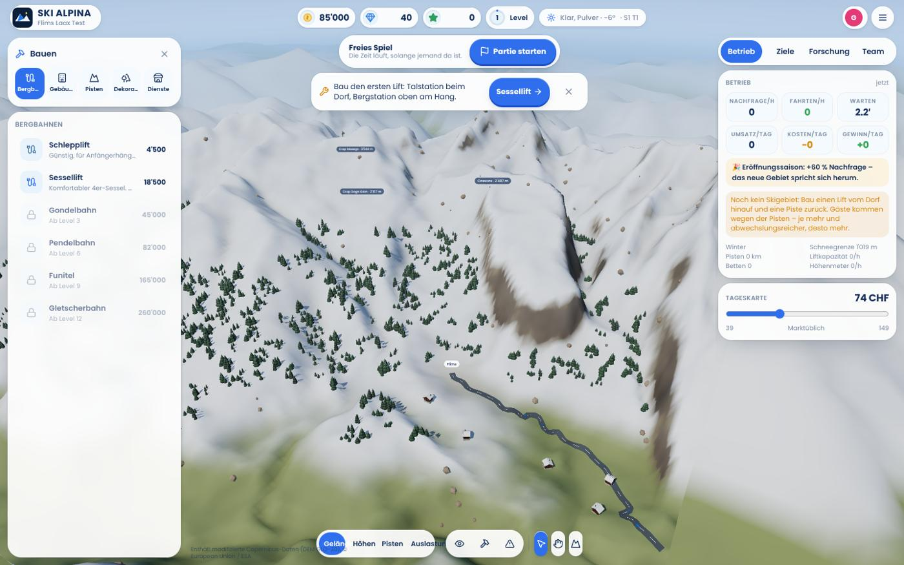
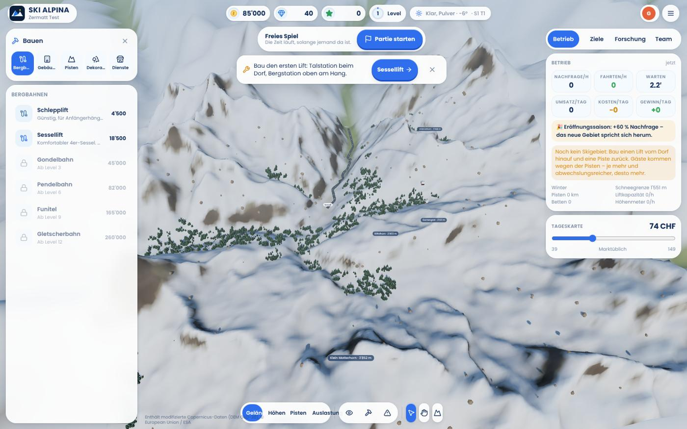
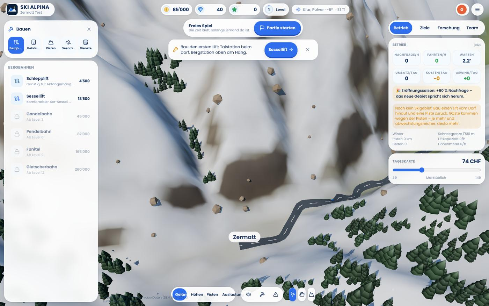
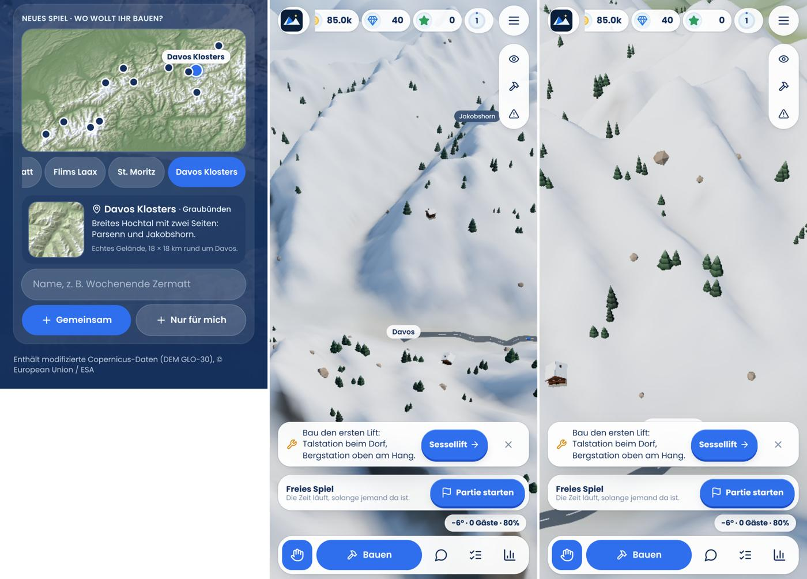

# Regionen mit echtem Gelände

**Status:** umgesetzt

## Warum

Das bisherige «Zermatt» war kein echtes Gelände: ein paar Gipfelpunkte mit
Exponential-Abfall, eine Talrinne und ein künstlich hochgezogener Rand. Das
machte es steil und eintönig, und am Kartenrand stand eine Kante, hinter der
erfundene Berge begannen.

## Was es jetzt gibt

- **Zwölf Skigebiete** (`packages/config/src/regions.ts`): Zermatt, Flims Laax,
  St. Moritz, Davos Klosters, Arosa, Verbier, Saas-Fee, Engelberg Titlis,
  Grindelwald, Andermatt, St. Anton, Chamonix. Jedes ist ein Fenster von
  18 × 18 km mit echten Höhen.
- **Daten**: `scripts/build-regions.mjs` holt die AWS Terrain Tiles
  (Copernicus DEM / SRTM, offen), rechnet sie auf das Spielraster um (160 × 160,
  ~113 m) und legt sie als `packages/shared/src/terrain/regions/<id>.ts` ab,
  dazu das Umland (90 × 90 km) für den Horizont und Reliefbilder für die
  Auswahl (`public/regions/`). Die Daten liegen im Repo; weder Server noch
  Browser brauchen dafür Internet. Im Browser wird nur die gewählte Region
  nachgeladen (~73 KB gzip).
- **Gleiche Spielregeln überall**: Jede Region wird so verschoben, dass ihr
  Dorf auf 1'600 Spielmetern liegt (`VILLAGE_GAME_ELEV`). Höhenregeln (wo ein
  Hotel stehen darf, Schneegrenze, Gletscherbahn) bedeuten damit in Flims
  (1'080 m) dasselbe wie in Saas-Fee (1'800 m). Angezeigte Höhen
  (Schneegrenze, Höhenprofil, Gipfel) sind die echten.
- **Pro Spiel gespeichert**: `ResortState.region`; der Server lädt beim Start
  alle Regionen, jedes Spiel rechnet auf seinem eigenen Gelände. Alte
  Spielstände bleiben auf dem klassischen Tal («Alpina»).
- **Auswahl** beim neuen Spiel: Reliefkarte der Alpen mit Markierungen, Liste
  zum Antippen, Vorschau und Kurzbeschreibung.
- **Nahtloser Horizont**: Hinter dem Spielfeld geht das echte Umland weiter
  (gleiche Daten, gröberes Raster), statt erfundener Ketten hinter einem Rand.
- **Startkamera** pro Region: auf der Dorfseite, Blick zu den Bergen.
- **Talstrasse** (`canvas/valley-road.ts`): vom Punkt, an dem die Talsohle die
  Karte verlässt, ins Dorf — Dijkstra über das Gelände mit starker Strafe für
  Steigungen, damit sie der Talsohle folgt und Stufen in Kehren nimmt. Als
  Asphalt im Pistennetz (kein zusätzlicher Draw Call). Die Autos fahren auf
  ihr, rechts hinein und hinaus.

## Tests

`terrain/regions.test.ts` (Laden, Dorfhöhe, Relief, baubarer Platz am Dorf,
Himmelsrichtungen), `runtime/saves.test.ts` (neues Spiel auf gewählter Region),
`canvas/valley-road.test.ts` (Strasse vom Rand ins Dorf, befahrbar, von unten).

## Bilder

